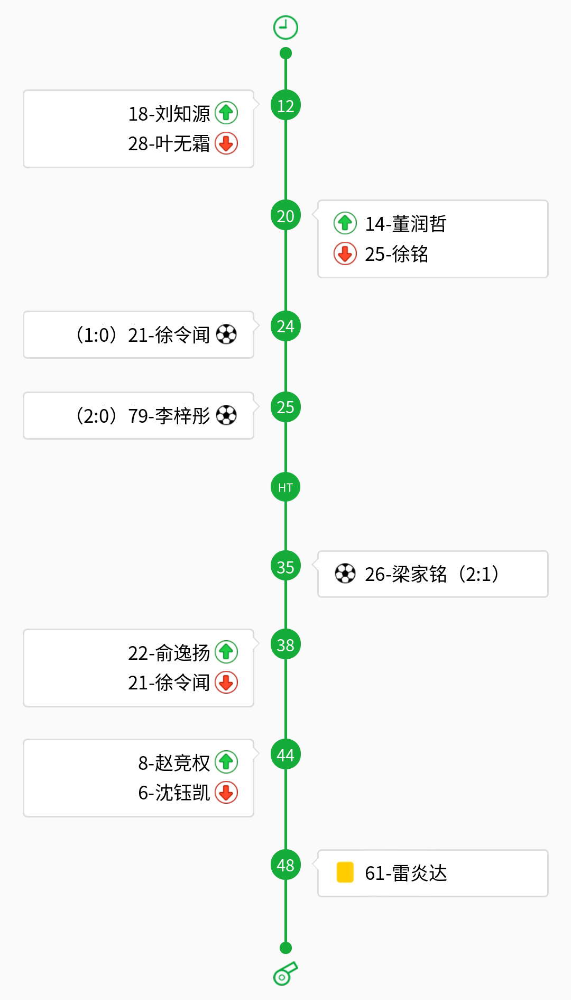

# tj-cup-report

同济大学足协杯战报流水线 —— 一个给 [DeepSeek Harness](https://github.com/deepseek-ai/dsh) 用的 skill。

从一张**比赛报告单**出发，产出三样东西：

1. **时间轴图**（比赛进程 PNG）—— 按足协官方素材拼的标准图，左队文字右对齐、右队左对齐、中轴严格居中
2. **战报 DOCX** —— 标题 / 比分 / 赛事简讯 / 双方首发 / 比赛进程 / 精彩瞬间
3. **视频片段** —— 按时间点裁好的 7–10 秒片段，自动识别并裁掉手机录像的黑边



## 为什么会有这东西

写一篇战报的活儿本身不难，难的是每次都重复踩同样的坑：

- 报告单是手写的，`28` 和 `30` 长得像
- 手机录像是竖屏，真画面却是中间一条 16:9
- 录像时间 ≠ 比赛分钟，得先算偏移量
- 微信里的视频常常只下载了一半，元数据写着 22 分钟、实际只有 55 秒
- 官方素材包里混着截图留下的灰边，拼上去会有莫名其妙的横线
- 时间轴的文字左对齐还是右对齐，公众号排版时要命地显眼

这个 skill 把这些都固化下来了：素材、几何、对齐、坑，全在里面。

## 安装

```bash
git clone git@github.com:<you>/tj-cup-report.git ~/.dsh/skills/tj-cup-report
```

然后准备运行环境（一次就够）：

```bash
cd ~/.dsh/skills/tj-cup-report
python3 -m venv .venv
.venv/bin/pip install pillow numpy python-docx imageio-ffmpeg
```

中文字体：`sudo apt install fonts-noto-cjk`（脚本会自动找可用字体）。

## 用法

写好一份 `spec.json`（格式见 `references/spec-example.json`），然后：

```bash
.venv/bin/python scripts/timeline.py spec.json   # → 比赛进程.png
.venv/bin/python scripts/report.py   spec.json   # → 战报 xxx.docx
.venv/bin/python scripts/clips.py    spec.json   # → 视频1.mp4 + 视频1_横屏.mp4 …
```

`spec.json` 的最小结构：

```json
{
  "match": { "home": "奶龙国际", "away": "折耳根", "score": [2, 3],
             "home_starters": ["2-周子泙", "..."], "away_starters": ["1-张毅恒", "..."] },
  "events": [
    {"minute": 23, "type": "sub",  "side": "home", "on": ["10-薛振宇"], "off": ["2-周子泙"]},
    {"minute": 28, "type": "goal", "side": "home", "player": "10-薛振宇", "score": [1, 0]},
    {"minute": 45, "type": "ht",   "label": "HT"},
    {"minute": 48, "type": "card", "side": "away", "player": "61-雷炎达", "kind": "黄牌"}
  ],
  "clips": [{"n": 1, "src": "录像.mp4", "start": "0:17", "end": "0:24", "crop": true}],
  "report": { "title": "足协杯丨……", "lead": "……",
              "highlights": [{"text": "第28分钟，……（1:0）", "video": "视频1"}] }
}
```

## 能力细节

| 脚本 | 做了什么 |
|---|---|
| `timeline.py` | 事件排序、同分钟双方换人自动合并、进球比分自动累加、超长姓名自动缩字号、素材杂边自动清理、HT/红黄牌节点 |
| `report.py` | A4 版式、等线 12pt、标题 16pt 居中、时间轴独占一页且固定 9.2cm 宽、进球句自动加粗 |
| `clips.py` | 自动测黑边并裁成横向、统一 H.264 + AAC、同时输出原样与横屏两版 |

## 目录

```
SKILL.md                  流程、写作规范、踩坑清单（给 agent 看的入口）
scripts/timeline.py       事件 JSON → 时间轴 PNG
scripts/report.py         事件 JSON → 战报 DOCX
scripts/clips.py          时间点 → 视频片段
assets/timeline/          官方时间轴素材（30 张，勿改文件名）
references/editorial-rules.md   宣传部《战报撰写指导说明》的整理版
references/spec-example.json    完整样例（奶龙国际 2:3 折耳根）
```

## 说明

素材 `assets/timeline/` 来自同济大学足球协会发布的时间轴素材包，仅用于校内赛事战报排版。
代码部分 MIT。

## License

MIT
